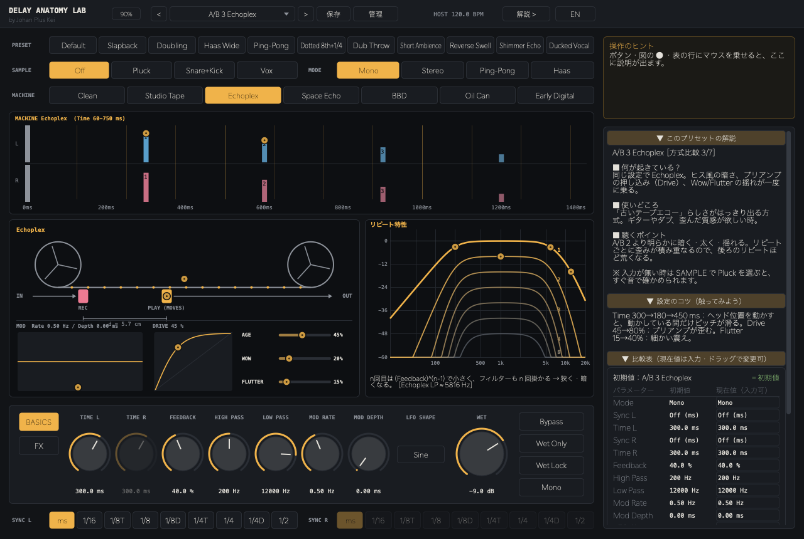

# Delay Anatomy Lab（JUCE プラグイン）

by Johan Plus Kei — ディレイの方式の違いと使い分け、パラメーターの設定のコツを「動かして・見て・聴いて」学べる VST・AU 対応プラグイン（VST3 / AU / Standalone）。Clean・テープ・Echoplex・Space Echo・BBD・Oil Can・初期デジタルの7方式を、原理図・リピート特性・タイムラインの3つの図で見比べられます。



🔗 **学習ラボ・解説ページ / Learning labs & articles：** [Learning labs（GitHub Pages）](https://kazufumi01.github.io/) ・ [目次・解説記事（Seesaa・日本語）](https://jpk.seesaa.net/article/521891797.html)

## ⬇️ ダウンロード / Download

**[最新版をダウンロード / Download latest](https://github.com/kazufumi01/DelayAnatomyLab/releases/latest)** — 無料配布中 / Free

| | 手動インストール（おすすめ） | インストーラー |
|---|---|---|
| **Mac**（macOS 11+, Apple Silicon / Intel） | [`DelayAnatomyLab-1.0.0-mac.zip`](https://github.com/kazufumi01/DelayAnatomyLab/releases/latest/download/DelayAnatomyLab-1.0.0-mac.zip) | [`DelayAnatomyLab-1.0.0-mac.pkg`](https://github.com/kazufumi01/DelayAnatomyLab/releases/latest/download/DelayAnatomyLab-1.0.0-mac.pkg) |
| **Windows**（10 / 11, 64bit）⚠️未検証 | [`DelayAnatomyLab-1.0.0-win64.zip`](https://github.com/kazufumi01/DelayAnatomyLab/releases/latest/download/DelayAnatomyLab-1.0.0-win64.zip) | [`DelayAnatomyLab-1.0.0-win64.exe`](https://github.com/kazufumi01/DelayAnatomyLab/releases/latest/download/DelayAnatomyLab-1.0.0-win64.exe) |

- インストール方法：**[INSTALL.md](INSTALL.md)**（日本語 / English）
- ⚠️ **Windows 版は実機での動作確認ができていません**（自動ビルドで作成。VST3 と Standalone）。 / The Windows build is untested on real hardware.
- Apple の公証・Windows のコード署名をしていないため、初回のみ警告が出ます。
- 不具合・要望は [Issues](https://github.com/kazufumi01/DelayAnatomyLab/issues) へ。

---

## 主な機能

- **7つの方式（MACHINE）**：Clean／Studio Tape／Echoplex／Space Echo／BBD／Oil Can／Early Digital。選ぶと、その機種らしい Age・Drive・Wow・Flutter が入り、A/B で「何が足されたか」を聴き比べられる
- **4つのモード**：Mono／Stereo／Ping-Pong／Haas
- **3つの図を同時に表示**：タイムライン（エコーが返る位置）・原理図（信号の流れ）・リピート特性（回ごとのレベルと帯域）。図の ● をドラッグしてパラメーターを直接動かせる
- **使い分けプリセット**：方式の聴き比べ（A/B）、場面別の例、定番、FX、コーラス／フランジャー（LFO）など52種。解説に「何が起きているか・使いどころ・聴くポイント・設定のコツ」付き
- **BASICS / FX の操作域**：Time L/R・Feedback・High Pass・Low Pass・Mod Rate / Depth・Wet、FX は Pitch・Fine・Duck・Release・Reverse
- **LFO 波形の選択**：Sine／Triangle／Saw／Square／Random。コーラス・フランジャー、古い BBD コーラスの質感が作れる
- **比較表**：プリセットの値と現在値を並べ、変えた項目を強調。値はドラッグや数値入力でも変更できる
- **テンポ同期**（L/R 別）、Wet Lock、Wet Only、Mono Check、内蔵サンプル音（Pluck／Snare+Kick／Vox）
- マウスオーバーで、ボタン・図・表・パラメーターの説明を右上の説明欄に表示。配色、ウィンドウ倍率、日本語 / English

---

## ビルド

```bash
./build.sh            # 手元の JUCE（~/Documents/jpkplugins/JUCE）を使う。無ければ CMake が JUCE 9.0.4 を取得
```

- Windows は GitHub Actions（`.github/workflows/build-win.yml`、手動実行）で VST3 / Standalone をビルドし、Inno Setup でインストーラーを作成
- Mac のインストーラー作成：`packaging/mac/build_pkg.sh [version]` ／ `packaging/mac/build_zip.sh [version]`（出力は `dist/`）

## ライセンス

JUCE は **Starter ライセンス** で使用。配布物はフリーウェア使用許諾（`packaging/mac/resources/license.txt`）に従います。
ソースは学習目的で公開していますが、無断での再配布・販売はできません。

---

**Johan Plus Kei** — [Spotify](https://open.spotify.com/artist/30PV2gqUbDDwvuWtKaok0x) ・ [Apple Music](https://music.apple.com/us/artist/johan-plus-kei/519360150) ・ [X](https://x.com/johanpluskei) ・ [Instagram](https://www.instagram.com/johanpluskei) ・ [Learning labs](https://kazufumi01.github.io/)

## Support / 支援

Delay Anatomy Lab is free. If it helps your mixing or your classes, you can support development with a one-time tip via [PayPal](https://paypal.me/johanpluskei). More ways to help: <https://kazufumi01.github.io/support/>

Delay Anatomy Lab は無料です。ミックスや授業で役立ったら、[PayPal](https://paypal.me/johanpluskei) からの投げ銭で開発を支えていただけるとうれしいです。
